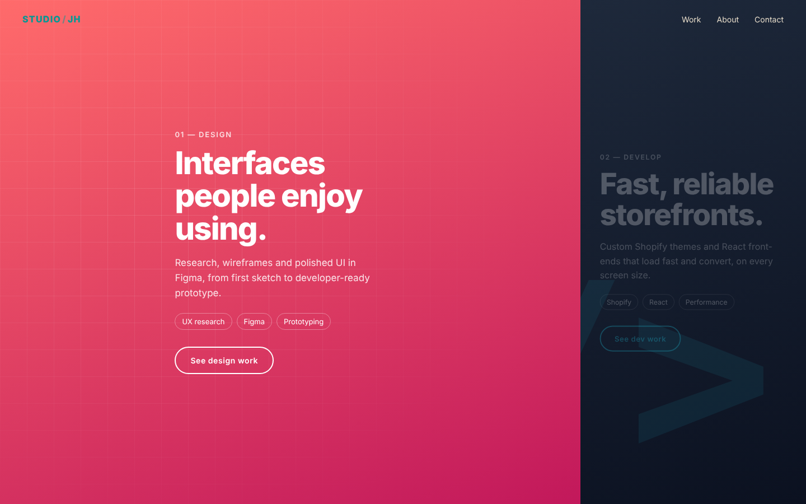

# Split Landing Page

A two-sided landing page for a design and development studio. Hover (or tab to) either side and it expands to take focus while the other side recedes.

**Live demo:** https://jhwang2525.github.io/split-landing-page/

## Features

- Smooth width transition with a custom easing curve
- The inactive side fades and scales down to keep attention on the active one
- Works with the keyboard as well as the mouse
- Stacks into full-height sections on mobile
- Pure CSS backgrounds (gradients, grid mask and code motif), so there are no images to load
- Respects `prefers-reduced-motion`

## Built with

HTML, CSS and vanilla JavaScript.
